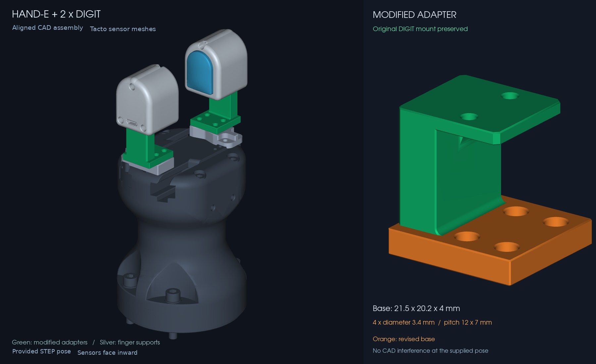

# Hand-E + DIGIT

Robotiq Hand-E에 DIGIT 센서 2개를 장착하기 위한 어댑터 CAD와 ROS 2 설명 패키지입니다. 기존 2F85 어댑터의 **DIGIT 장착부를 보존**하고 하부 체결부를 Hand-E 핑거 서포트에 맞췄습니다.



## 바로 사용할 파일

| 파일 | 용도 | 단위 |
| --- | --- | --- |
| [수정 어댑터 STL](output/DIGIT-HandE-Adapter.stl) | 어댑터 출력용 단일 폐쇄 메시 | mm |
| [수정 어댑터 STEP](output/DIGIT-HandE-Adapter.step) | 어댑터 CAD 솔리드 | mm |
| [최종 조립 STL](output/HandE-DIGIT-Assembly.stl) | 본체 + 서포트 2개 + 어댑터 2개 + 센서 2개 | mm |
| [ROS 패키지](robotiq_digit_description/) | URDF, Xacro, 메시, RViz 설정 | m |
| [검증 결과](output/validation.json) | 치수, 원본 해시, 좌표 변환, 간섭 및 URDF 검사 | mm / 항목별 명시 |

조립 STL은 여러 부품을 담은 표시용 모델입니다. 어댑터 제작에는 별도 어댑터 STL을 사용합니다. URDF는 원본 STEP의 자세를 재현하는 **고정 조립 모델**입니다.

## 폴더 구조

```text
robotiq_digit_add/
├── input/                       # 제공된 원본 CAD 3개
├── output/                      # 완성 CAD, 조립 STL, 미리보기, 검증 결과
│   └── intermediate/            # 재생성 가능한 중간 CAD; Git 제외
├── robotiq_digit_description/    # 바로 빌드할 수 있는 ROS 2 패키지
├── scripts/                     # CAD 생성, 센서 조립, 패키징, 렌더링
├── third_party/tacto/           # Tacto 원본 센서와 라이선스
├── dist/                        # 배포용 ZIP; Git 제외
└── requirements-cad.txt         # 재생성 도구의 Python 의존성
```

`output/`의 완성 파일과 ROS 패키지의 실행용 메시를 저장소에 포함합니다. `output/intermediate/`, `dist/`, Python 캐시 및 ROS 빌드 결과는 `.gitignore`에서 제외합니다. ZIP이 필요하면 재생성 명령의 `--archive` 옵션을 사용합니다.

## ROS 2에서 열기

ROS 2 환경을 활성화하고 `xacro`, `robot_state_publisher`, `rviz2`가 설치된 상태에서 저장소 루트에서 실행합니다.

```bash
colcon build --packages-select robotiq_digit_description
source install/setup.bash
ros2 launch robotiq_digit_description display.launch.py
```

기존 로봇에 Xacro로 연결하거나 독립 URDF 로더에서 사용하는 방법은 [패키지 안내](robotiq_digit_description/README.md)에 있습니다.

## CAD와 패키지 재생성

Python 3.11에서 검증했습니다. 입력 CAD와 Tacto 원본 메시가 저장소에 포함되어 있어, Python 의존성 설치 후에는 모델을 다시 다운로드할 필요가 없습니다.

```bash
python3 -m venv .venv
source .venv/bin/activate
python -m pip install -r requirements-cad.txt
python scripts/rebuild.py --archive
```

이 명령은 어댑터 및 조립 CAD 생성 → DIGIT 센서 배치 → URDF/Xacro 생성·검증 → 미리보기 렌더링 → `dist/robotiq_digit_description.zip` 생성을 수행합니다. 실행 중 검증에 실패하면 중단합니다.

개별 단계도 실행할 수 있습니다.

```bash
python scripts/build_assembly.py
python scripts/package_robot.py
python scripts/render_preview.py
```

렌더링은 VTK의 OpenGL 환경이 필요합니다. 렌더링을 생략하려면 `python scripts/rebuild.py --skip-preview`를 사용합니다. 이 경우 기존 미리보기는 갱신되지 않습니다.

## 설계와 좌표

| 항목 | 값 |
| --- | --- |
| 하부 플레이트 | 21.5 × 20.2 × 4 mm |
| 체결 구멍 | Ø3.4 mm × 4개 |
| 체결 피치 | 12 × 7 mm |
| 보존 영역 | 원본 어댑터의 z ≥ 4 mm, 센서 고정부 포함 |
| 조립 원점과 축 | 제공된 Hand-E 본체 STEP과 동일 |
| 패키지 메시와 URDF 이동량 | m, mesh scale="1 1 1" |

본체 좌표의 +Y는 센서 쪽, Z는 좌우 센서 사이 방향입니다. 두 센서의 접촉면은 서로 마주보며, 센서 링크의 로컬 좌표는 Tacto 원본을 유지합니다. 본체 STEP 원점과 로봇 손목 플랜지 사이의 설치 변환은 사용하는 로봇에 맞춰 지정해야 합니다.

## 검증 범위

어댑터의 보존 영역, 단일 폐쇄 메시, STEP 솔리드, 체결 구멍 정렬, CAD 부품 간 간섭, 센서 배치, Xacro 확장, URDF 트리와 메시 경로, CAD와 URDF의 좌표 일치를 검사합니다. 원본 CAD의 해시는 [검증 파일](output/validation.json)에 기록됩니다.

현재 모델은 9개 링크와 8개 고정 조인트로 구성됩니다. 가동 관절·하드웨어 제어·동역학용 관성은 포함하지 않습니다. ROS 2/RViz 실행과 실물 출력·체결·하중 시험은 미검증입니다. 케이블과 추가 체결 나사는 모델에 포함하지 않았습니다.

## 출처

- 원본 CAD: [input/](input/), 제공된 세 파일을 그대로 보존.
- DIGIT 센서: [facebookresearch/tacto](https://github.com/facebookresearch/tacto/tree/a21d0c4626d74a546d94859226c2fea348babb6a/meshes), 고정 커밋 `a21d0c4626d74a546d94859226c2fea348babb6a`.
- Tacto 자산의 MIT 라이선스: [third_party/tacto/LICENSE](third_party/tacto/LICENSE).

CAD 원본의 권리는 해당 원본 조건을 따릅니다. Tacto 파일의 출처·라이선스는 ROS 패키지에도 포함되어 있습니다.
