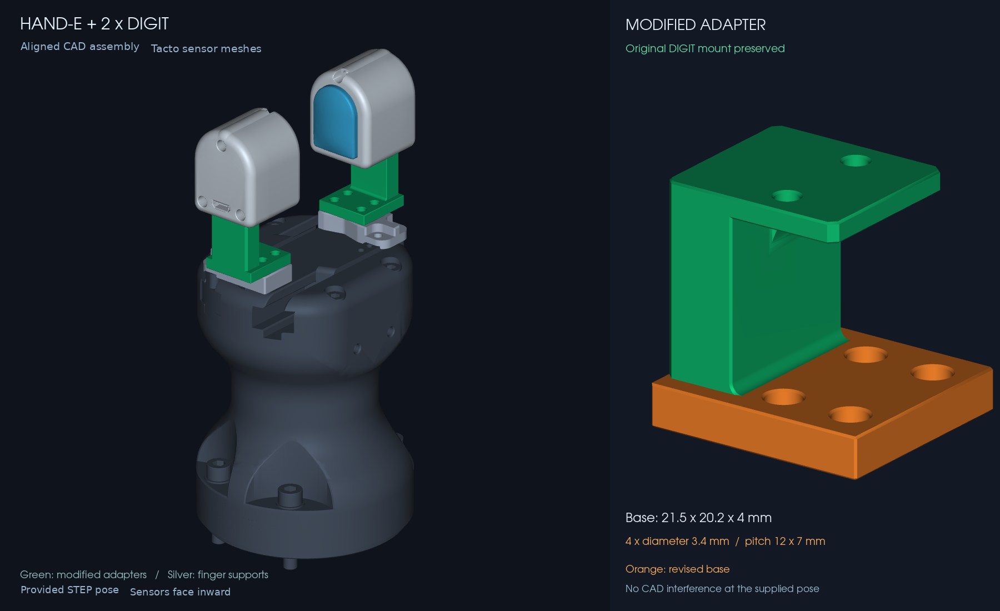

# robotiq_digit_description

Hand-E 본체 1개, 핑거 서포트 2개, 수정 어댑터 2개, Tacto DIGIT 센서 2개를 포함한 ROS 2 설명 패키지입니다. 원본 CAD 자세를 재현하는 **고정 조립 모델**이며 9개 링크와 8개 fixed joint로 구성됩니다.



## 파일

| 파일 | 용도 |
| --- | --- |
| [robotiq_digit_assembly.urdf](urdf/robotiq_digit_assembly.urdf) | `package://` 경로를 사용하는 ROS용 URDF |
| [robotiq_digit_assembly.portable.urdf](urdf/robotiq_digit_assembly.portable.urdf) | `../meshes/` 경로를 사용하는 독립 로더용 URDF |
| [robotiq_digit_assembly.urdf.xacro](urdf/robotiq_digit_assembly.urdf.xacro) | 독립 로봇 설명을 생성하는 Xacro |
| [robotiq_digit_macro.xacro](urdf/robotiq_digit_macro.xacro) | 기존 로봇에 연결하는 매크로 |
| [meshes/](meshes/) | 미터 단위 시각·충돌 메시 |
| [validation.json](validation.json) | CAD 및 패키지 검증 결과 |

## ROS 2 실행

이 폴더를 ROS 2 워크스페이스의 `src/`에 넣거나, 이 패키지를 포함한 저장소 루트에서 빌드합니다. ROS 2 환경을 활성화하고 `xacro`, `robot_state_publisher`, `rviz2`를 설치해야 합니다.

```bash
colcon build --packages-select robotiq_digit_description
source install/setup.bash
ros2 launch robotiq_digit_description display.launch.py
```

RViz 없이 TF와 `robot_description`만 발행하려면 다음 명령을 사용합니다.

```bash
ros2 launch robotiq_digit_description display.launch.py rviz:=false
```

모든 조인트가 고정되어 있으므로 joint state publisher는 필요하지 않습니다.

## 독립 로더와 Xacro 변환

상대 메시 경로를 지원하는 로더에는 `urdf/robotiq_digit_assembly.portable.urdf`의 절대 경로를 전달합니다. 이 모델의 사용 범위는 고정 조립 표시와 형상 검사이며, 물리 시뮬레이션용 질량·관성은 정의하지 않았습니다.

패키지 폴더에서 메시 경로를 지정해 URDF를 만들 수도 있습니다.

```bash
xacro urdf/robotiq_digit_assembly.urdf.xacro \
  mesh_prefix:="$(pwd)/meshes/" > /tmp/robotiq_digit_assembly.urdf
```

## 기존 로봇에 연결

```xml
<xacro:include filename="$(find robotiq_digit_description)/urdf/robotiq_digit_macro.xacro"/>
<xacro:robotiq_digit_assembly
    prefix="gripper_"
    parent="tool0"
    xyz="0 0 0"
    rpy="0 0 0"/>
```

`xyz`와 `rpy`를 `tool0`에서 본체 STEP 원점까지의 실제 설치 변환으로 설정합니다. 위의 0 값은 문법 예시입니다. `prefix`는 모든 링크와 조인트 이름에 적용됩니다.

## 좌표와 단위

- `hand_e_base_link`의 원점과 XYZ 방향은 제공된 Hand-E 본체 STEP과 같습니다. 별도로 측정한 손목 플랜지 원점은 아닙니다.
- +Y는 본체에서 센서 방향, Z는 좌우 센서 사이 방향입니다.
- 모든 패키지 메시와 URDF 위치는 **m** 단위이고 `mesh scale="1 1 1"`입니다. 저장소의 `output/` CAD와 STL은 **mm** 단위입니다.
- `digit_left`, `digit_right`는 Tacto 원본 센서 좌표를 유지합니다. 센서 +X 방향은 본체의 -Z, +Z로 서로 마주봅니다.
- `digit_*_gel`은 Tacto 설정의 `[0.022, 0, 0.015]` m 기준 프레임입니다. 메시 표면 최외곽을 측정해 정의한 값은 아닙니다.

본체 메시에는 원본 STEP의 슬라이더까지 들어 있습니다. 가동 모델로 확장하려면 슬라이더를 별도 링크로 분리해야 합니다.

## 자산과 검증

DIGIT 시각 메시는 [Tacto 원본](https://github.com/facebookresearch/tacto/tree/a21d0c4626d74a546d94859226c2fea348babb6a/meshes)의 바이트와 단위를 유지했습니다. [third_party/tacto/](third_party/tacto/)에 원본 URDF, 설정, 출처와 [MIT 라이선스](third_party/tacto/LICENSE)가 있습니다. 제공된 CAD의 권리는 해당 원본 조건을 따릅니다.

Tacto 원본 메시의 열린 내부 표면은 유지하고, DIGIT 충돌 메시에는 동일 형상의 닫힌 convex hull을 사용합니다. 촉각 센서 시뮬레이션과 하드웨어 제어는 별도 구성이 필요합니다.

Xacro 확장, URDF 트리, 메시 경로, 단위, 부모 링크·접두사 연결 및 CAD와의 좌표 일치를 검증했습니다. ROS 2/RViz 실행과 실물 체결·하중 시험은 미검증입니다. 케이블과 추가 체결 나사는 모델에 포함하지 않았습니다.
